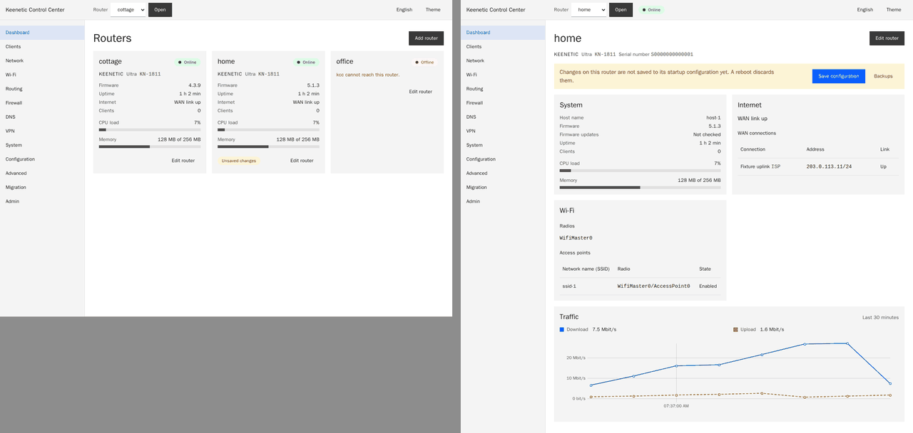

# Keenetic Control Center (kcc)

kcc manages Keenetic and Netcraze routers through their RCI HTTP API. It's one binary
with three front ends that share the same accounts, permissions, audit log and change
workflow:

- a **Web UI**, the main interface: fleet dashboard, clients, DHCP, segments, network
  and Wi-Fi, routing, NAT, firewall, DNS, VPN, system pages, configuration backups,
  presets, migration between routers, a command explorer, and user, role and API-key
  administration;
- an **MCP server** (Streamable HTTP with API keys, or stdio) for AI assistants;
- a **command-line interface** (`kcc --help`).

kcc is unofficial and is not affiliated with Keenetic Limited or Netcraze.



More screenshots: [clients](docs/images/clients.png), [network](docs/images/network.png),
[firewall](docs/images/firewall.png), [DNS](docs/images/dns.png),
[system](docs/images/system.png), [presets](docs/images/presets.png),
[migration wizard](docs/images/migration.png), [audit log](docs/images/audit.png).
The [user guide](docs/USER_GUIDE.md) walks through every page.

## Supported firmware and models

| Firmware line | Tier |
|---|---|
| 5.2 | `documentation-based` (uses the 5.1 command catalog) |
| 5.1 | `hardware-verified` |
| 5.0 | `documentation-based` |
| 4.3 LTS | `documentation-based` |
| Older than 4.3 | `unsupported` |

`documentation-based` lines are built from the official command reference manuals and
tested only against the router simulator in `kcc-testkit`. The live hardware campaign
has not run yet, so no line carries live evidence today. Details, and what differs
between lines, are in [docs/FIRMWARE.md](docs/FIRMWARE.md).

Models come from the official manuals (catalog in [catalog/](catalog/README.md)). The
simulator models KN-1811, KN-1010, KN-3810 and NC-3013. Netcraze models map to their
nearest Keenetic hardware family; that mapping is unverified on Netcraze hardware.

## Install

**Release archives.** Download the archive for your platform from the GitHub releases
page and check it against `SHA256SUMS`:

```text
sha256sum -c SHA256SUMS --ignore-missing
```

Each archive holds the `kcc` binary, the licenses, this file and `kcc.example.toml`, a
sample configuration listing every kcc setting with its default.

**Container.** The OCI image runs as UID 65532 on a distroless base under a seccomp
allowlist. [deploy/podman/README.md](deploy/podman/README.md) covers rootless Podman,
secrets, volumes, the Quadlet unit and the seccomp profile.

**Privilege floor.** kcc refuses to run as root, under sudo or elevated on Windows: it
exits with code 77 before doing anything else. On Linux it also drops every capability
and sets `no_new_privs`. A process whose only root identity is group ID 0 (as in some
container platforms) starts with a warning. Run it as an ordinary user.

## Quick start

1. Create `kcc.toml` in the config directory (`~/.config/kcc/kcc.toml` on Linux). kcc
   contacts only routers inside `[outbound] allowed_networks`:

   ```toml
   [outbound]
   allowed_networks = ["192.168.1.0/24"]
   ```

   Both `allowed_networks` and `allowed_suffixes` are empty by default, so a fresh
   install refuses every router until you name its network. `kcc router add`,
   `kcc router test`, the Web UI's router form and every command on a router from
   `[[routers]]` then say which setting to change and show the router's address, and
   `kcc serve` logs one warning at startup when routers are configured but both lists
   are empty.

2. Create the first administrator and add a router. The examples in this repository
   use `$ROUTER_URL` for the router address (for example `http://192.168.1.1`) and a
   file `router.pw` holding the router's admin password. Only you may read it: kcc
   refuses a secret file that group or others can read. Create it owner-only, for
   example:

   ```text
   umask 077
   printf '%s\n' 'the-router-password' > router.pw
   ```

   Then:

   ```bash kcc-doc-test
   kcc admin init
   kcc router add home --url "$ROUTER_URL" --login admin --password-file router.pw
   kcc router test --router home
   ```

   `kcc admin init` prints the administrator's password once; you change it at the
   first login. `kcc router add` seals the password under the master key and keeps no
   reference to `router.pw`, so you can delete the file afterwards. A login token
   (`--auth token --token-file <file>`) and a read-only polling login
   (`--read-login <name> --read-password-file <file>`) are sealed the same way.

3. Start the server and open <http://127.0.0.1:8443/ui/> in a browser:

   ```text
   kcc serve
   ```

Routers can also be added in the Web UI (Dashboard, Add router), with the same
password, token and read-only login options, sealed the same way. Plain HTTP is
accepted only on loopback; any other listener needs TLS
(`kcc tls self-signed --host <name>` writes a certificate pair) or an https
`public_url` behind a trusted proxy. Every setting is described in
[docs/CONFIG.md](docs/CONFIG.md).

## Command line

The CLI reads the same `kcc.toml` and state directory as the server. Writes run
through the same change workflow as the Web UI (backup, conflict check, read-back,
audit) and never save unless you ask:

```bash kcc-doc-test
kcc info
kcc clients list
kcc interfaces list
kcc interfaces description Bridge0 "Home network"
kcc config state
kcc config save
kcc backup create --reason before-upgrade
kcc backup list
kcc catalog search "ip route"
kcc show version
kcc --json info
kcc audit verify
```

Global options: `--router <id>` picks the router when more than one is configured,
`--json` prints one JSON document, `--lang` picks the output language (`en`, `ru`, `uk`,
`de`, `be` or `kk`; without it `KCC_LANG`, `LC_ALL` or `LANG`, else English). Changes that
can cut kcc off from the router need `--yes`; destructive ones need
`--confirm-destructive <router-id>`. Settings copy and migration commands are in
[docs/MIGRATION.md](docs/MIGRATION.md).

`kcc router add` and `kcc router edit` take the router's credentials as input only:
`--password-file`, `--token-file` and `--read-password-file` are read once and sealed
(without a file, `KCC_PASSWORD` or a hidden prompt supplies the secret;
`KCC_PASSWORD` stands in for one secret per command only). `--auth`
picks `auto`, `ndw2`, `ndw4`, `token` or `digest`. On `router edit`, `--new-password`,
`--new-token` and `--new-read-password` replace a credential and `--clear-read-login`
drops the read-only login; changing the URL, login or TLS pin needs the password or
token again in the same command and drops the read-only login unless it is given again.

## MCP for AI assistants

Two transports serve the same tools ([docs/MCP_TOOLS.md](docs/MCP_TOOLS.md)):

- **stdio**: set `[mcp] stdio_enabled = true`; the client starts `kcc mcp stdio`. The
  local identity gets the role in `[mcp] stdio_role` (default `viewer`). When stdin
  closes, or on SIGTERM or SIGINT, it finishes open change brackets and flushes the
  audit log before it exits, as `kcc serve` does.
- **HTTP**: `kcc serve` answers on `/mcp` and needs an API key in an
  `Authorization: Bearer` header. Create one per assistant; the key is printed once:

  ```bash kcc-doc-test
  kcc apikey create claude --role viewer
  ```

Claude Code:

```text
claude mcp add kcc -- kcc mcp stdio
claude mcp add --transport http kcc http://127.0.0.1:8443/mcp --header "Authorization: Bearer <key>"
```

Codex (`~/.codex/config.toml`):

```toml
[mcp_servers.kcc]
command = "kcc"
args = ["mcp", "stdio"]
```

Cursor (`.cursor/mcp.json`):

```json
{ "mcpServers": { "kcc": { "url": "http://127.0.0.1:8443/mcp", "headers": { "Authorization": "Bearer <key>" } } } }
```

Write tools appear only when the role allows them and the toolset is enabled in
`[mcp] toolsets`. Destructive tools, and raw changes to management settings, also need
`[mcp] allow_destructive = true` and `confirm: true` in the call; this server switch
stays required even for a role that holds `Destructive`. Applying a migration or preset
needs no server switch, but rolling it back does, and needs `Destructive` too. What an assistant may send to its model provider is
described in [docs/PRIVACY.md](docs/PRIVACY.md).

## Safety model

- **Permissions.** Built-in roles `viewer`, `operator` and `admin`, plus custom roles
  with router scopes. The Web UI, MCP and the CLI check the same permission before any
  router request. Migration, preset and settings-copy applies need `Read`, `Migrate`,
  `Write` and `Save` before any router request; the recovery timer kcc arms around a
  change is authorized by that change's own permission. The built-in `operator` can
  apply these operations and finish them by keeping or saving the changes.
  `Destructive` is needed only for a rollback finish, a component install, a raw
  restore of a saved configuration, and explicit timer control (`kcc config failsafe
  arm|rollback`, the keep-alive and the Web UI's standalone rollback).
  The notification and scheduled-action pages need `ManageNotifications` and
  `ManageSchedules`, which only the built-in `admin` holds. A scheduled action also needs
  its action's permissions on its router: a policy switch or backup `Write`, a reboot
  `Destructive`, a preset `Read`, `Migrate`, `Write` and `Save` on the target (plus
  `Read` and `Migrate` on its source router when it names one).
- **Change workflow.** Each write takes a per-router lease, makes an encrypted backup of
  the startup configuration, refuses if someone else changed the router in between,
  verifies the result by reading it back and appends a hash-chained audit entry.
- **Fail-safe.** Changes that can cut kcc off (management interface, the internet
  connection kcc uses, firewall on it) run under the router's fail-safe timer, which
  restores the saved configuration if kcc loses the router. Migration and preset applies
  always do. Moving, closing or redirecting the HTTP or HTTPS listener kcc's router URL
  uses is refused: change it on the router, then the URL in kcc.
- **Nothing is saved implicitly.** Saving to the startup configuration is a separate,
  explicit step.
- **Secrets stay out of output.** Reports, logs, audit entries and MCP results carry
  redacted values; revealing a secret needs the `RevealSecrets` permission and is
  audited. Router answers shown by `kcc show`, `kcc rci`, the MCP raw read tools and the
  Web command explorer are redacted the same way unless the role holds `RevealSecrets` on
  that router.
- **Managed router credentials are sealed.** Every router password, login token and
  read-only polling password given to the Web UI or to `kcc router add/edit` (from a
  file, `KCC_PASSWORD` or a prompt) is encrypted under the master key in
  `<state>/router-credentials/<id>.sealed`, `<id>.token.sealed` and `<id>.read.sealed`;
  the input file can be deleted afterwards. Back up `master.key` separately; state
  cannot recover these credentials without it. Only `kcc.toml` routers keep reading
  their operator-managed `password_file`/`token_file`/`read_password_file`.

The threat model is in [docs/SECURITY.md](docs/SECURITY.md).

## Limitations

- No firmware line has live hardware evidence yet; see [docs/FIRMWARE.md](docs/FIRMWARE.md).
- kcc refuses to change the password of the router accounts it logs in with (the
  profile's login and its read-only login) and sends nothing to the router; under an API
  token profile, which names no login, it refuses every router-account password change. Change that password on the router, then run
  `kcc router edit <id> --new-password`. Migrations and presets change it only when you
  supply the new password, in their management phase (see docs/MIGRATION.md).
- API keys and accounts changed with the CLI (`kcc apikey create|revoke`,
  `kcc user disable`, `kcc user passwd`) reach a running `kcc serve` within about
  2 seconds, the time between its checks of the state files; changes on the Web UI
  administration page apply at once. The same checks follow the notification settings
  (`notify.json`, the sealed bot token) and `schedules.json`.
- OpenVPN credentials can't be written (the 5.1 catalog has no command for them); IPv6
  access lists are read-only (no catalog has `ipv6 access-list`).
- MCP migration plans, transient MCP presets and unsaved preset drafts in the Web UI live
  in memory and are lost on restart. An armed router timer still rolls the router back.
- Wide tables scroll sideways on phones without a visual cue.

[CHANGELOG.md](CHANGELOG.md) lists what exists today.

## Documentation

- [docs/USER_GUIDE.md](docs/USER_GUIDE.md): every Web UI area.
- [docs/MIGRATION.md](docs/MIGRATION.md): presets, settings copy and migration.
- [docs/CONFIG.md](docs/CONFIG.md): every `kcc.toml` key.
- [docs/SECURITY.md](docs/SECURITY.md): threat model and reporting.
- [docs/PRIVACY.md](docs/PRIVACY.md): what kcc stores and sends.
- [docs/ARCHITECTURE.md](docs/ARCHITECTURE.md): crates, data flow, change workflow.
- [docs/MCP_TOOLS.md](docs/MCP_TOOLS.md): MCP tools.
- [docs/MONITORING.md](docs/MONITORING.md) and [docs/METRICS.md](docs/METRICS.md):
  Prometheus metrics, dashboards, alerts and log forwarding.
- [docs/FIRMWARE.md](docs/FIRMWARE.md): firmware support tiers.
- [docs/I18N.md](docs/I18N.md): languages and translation workflow.
- [CONTRIBUTING.md](CONTRIBUTING.md), [THIRD_PARTY_NOTICES.md](THIRD_PARTY_NOTICES.md).

## License

Licensed under either of [Apache License, Version 2.0](LICENSE-APACHE) or
[MIT license](LICENSE-MIT) at your option.
