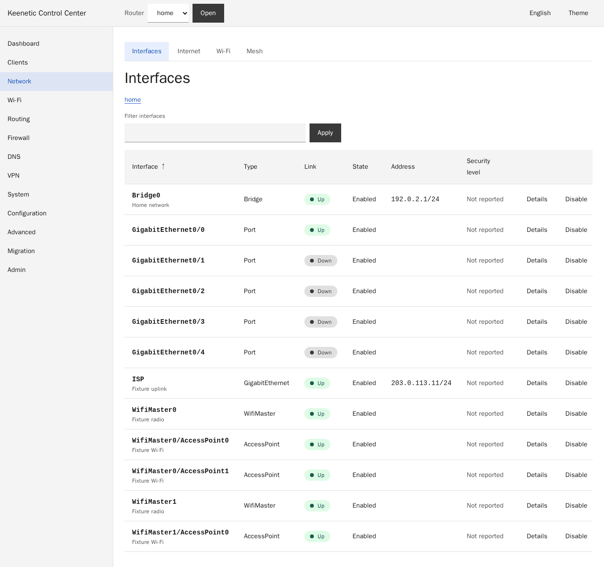
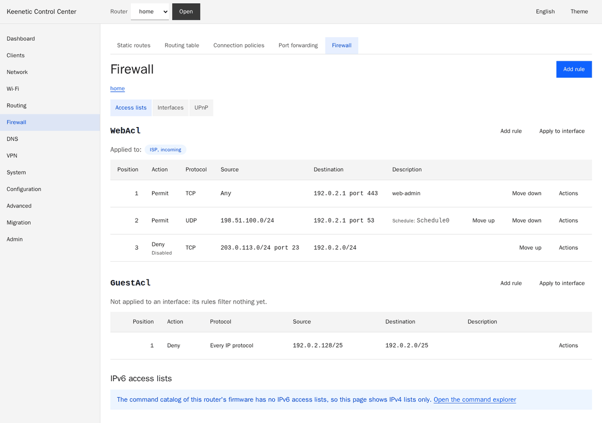
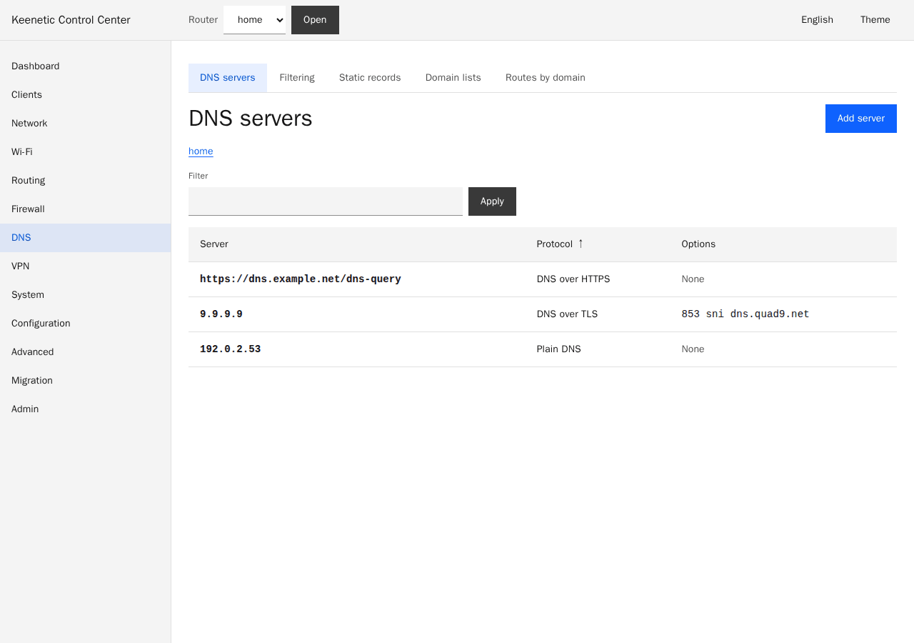
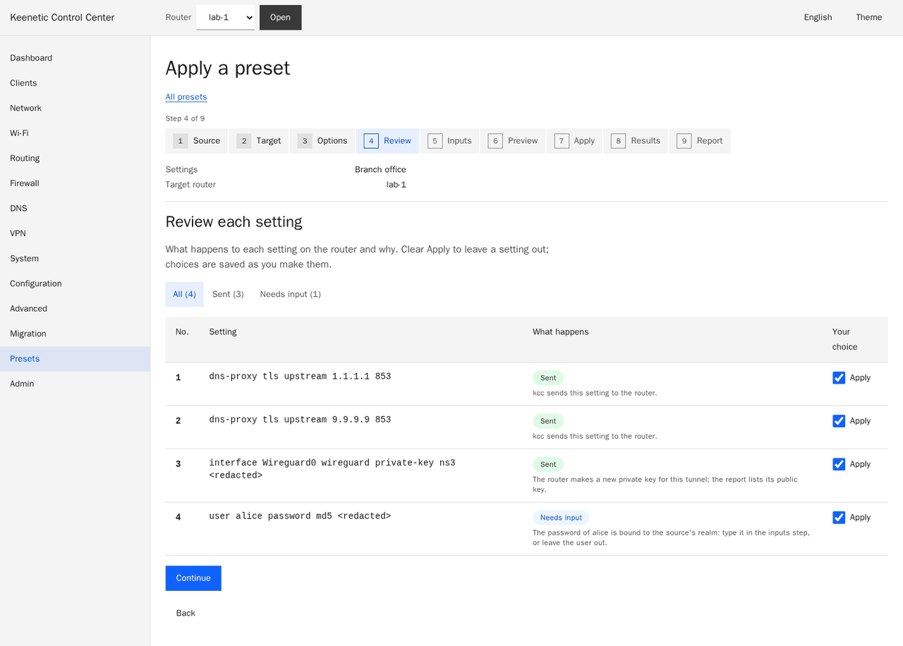
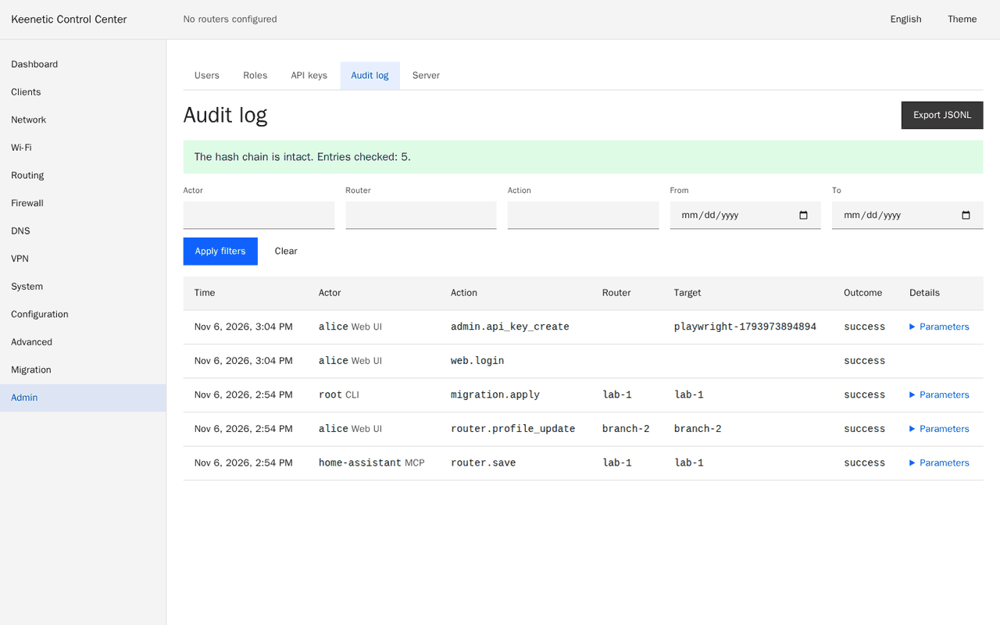

# User guide

This guide covers the kcc Web UI page by page. The UI lives under `/ui/` on the
address `kcc serve` listens on (default `http://127.0.0.1:8443/ui/`). Every page checks
your role: pages and buttons you have no permission for are hidden or answer
"Forbidden", and every change is written to the audit log.

## Common patterns

- **Router switcher.** The masthead's Router menu opens the dashboard of another router.
  Router pages live under `/ui/r/<router>/...`.
- **Changes.** A change dialog sends one validated request through the change workflow:
  kcc backs up the startup configuration, checks nobody else changed the router in the
  meantime, applies the change, reads it back and audits it. The result appears as a
  toast; the "Unsaved" badge in the masthead means the running configuration differs
  from the startup configuration. Nothing is saved until you press Save.
- **Risky changes.** Changes that can cut kcc off from the router (disabling or
  re-zoning the interface kcc reaches the router through, firewall rules on it) ask
  first, need the Destructive permission and run under the router's fail-safe timer.
  Deletions ask for confirmation; the most dangerous ones need the router or object name
  typed.
- **Tables** sort by a column header, filter with the search field and page at the
  bottom. On phones they scroll sideways without a visual cue.
- **Secrets** (Wi-Fi keys, VPN keys, passwords) show only as Set or Not set.

## Dashboard and fleet

`/ui/` shows one card per router with its status, model, firmware, support tier and
unsaved state, refreshed live. Admins with ManageRouters add, edit, test and remove
routers here (Add router). The router form takes the name, address, login, password,
certificate check (verify, or pin one certificate), tags and the `test_device` flag.
The pin is the SHA-256 of the router certificate's public key (SubjectPublicKeyInfo)
and applies to https addresses only. Test connection logs in without storing anything.
Routers defined in `kcc.toml` are read-only here.

A router's dashboard (`/ui/r/<router>`) shows host name, firmware, memory, internet and
WAN link state, WAN connections, radios and access points, the WAN traffic chart (the
last 30 minutes, kept in memory), the unsaved-changes banner with Save, and the
support-tier notice for documentation-based firmware. Firmware updates show "Not
checked": no update check is wired yet.

## Clients

`/ui/r/<router>/clients` lists connected and registered clients with filters for
online/offline and wired/wireless. Row actions: register or rename, allow or deny
access, assign a connection policy or schedule, set priority, wake-on-LAN, remove.

## DHCP

`/ui/r/<router>/dhcp` has tabs for pools, static leases, current bindings and ARP
neighbours. You can edit a pool and add a static lease ("Make static" on a binding fills
the form). Removing pools or static leases isn't offered yet.

## Segments

`/ui/r/<router>/segments` creates a network segment (VLAN, bridge, address, DHCP pool,
ports, access point, policy) step by step, rolling back finished steps if one fails.
The page doesn't list or delete existing segments yet; the CLI and MCP can delete
segments kcc created.

## Network

The network area has tabs:

- **Interfaces** (`/network`): every interface with state, address and traffic; a
  drawer shows details and a live traffic chart. Bring up or down, set the description
  or security level. Taking down the management interface is a risky change.
- **Internet** (`/internet`): WAN connections with priority order, default route,
  address mode (DHCP or static), MTU, identity and "connect via"; create and delete
  connections. Passwords aren't editable here.
- **Wi-Fi** (`/wifi`): access points and radios; turn an access point on or off, hide
  the SSID, edit settings. Pre-shared keys show as Set or Not set.
- **Mesh** (`/mesh`): mesh members with check, update and restart actions.

## Routing

The Routing section has tabs for static routes (IPv4 and IPv6, add and remove), the
routing table, and connection policies (create, description, permitted interfaces and
their order, multipath, delete). Removing a route runs a guard: if the router clears
more than the one route, kcc puts every other static route back and says so.

## NAT and port forwarding

`/ui/r/<router>/nat` lists port forwards (add, remove), NAT interfaces (add, remove) and
the active connection table, read in pages of 200.

## Firewall

`/ui/r/<router>/firewall` shows the IPv4 access lists with their rules, the interface
bindings and UPnP redirects. You can add, remove, move, enable or disable rules, set a
rule's description or schedule, and bind or unbind a list. A change that touches the
interface kcc reaches the router through is a risky change. IPv6 access lists are
read-only, because no firmware catalog has `ipv6 access-list`.

## DNS

`/ui/r/<router>/dns` has tabs for upstream servers (plain, DNS over TLS, DNS over
HTTPS), filtering (engine, profiles, assignments, intercept), static records, FQDN
lists and DNS routes. Removing upstreams, records, lists, routes or profiles isn't
offered yet.

## VPN

`/ui/r/<router>/vpn` lists VPN client connections (turn on or off, delete) and VPN
servers (service state, address pool, DNS, IPsec). WireGuard connections can be created
or imported from a `.conf` file: the router generates its own private key, and kcc
reports which fields of the file it didn't send (private key, preshared key, address,
DNS, ASC). Peers of a WireGuard tunnel are listed and added on their own page. Client
types other than WireGuard have no create form, and VPN credentials have no form.

## System

`/ui/r/<router>/system/...` has tabs:

- **General**: host name, description, time zone, NTP server, restart, factory reset.
  Host-name, description and time-zone changes are verified by a fresh read. Their
  simulator projection is documentation-derived; the real firmware shape is unconfirmed.
- **Router users**: router accounts and their tags; add and delete. kcc refuses to
  delete the account it logs in with.
- **Services**: turn router services on or off.
- **Components**: installed components; check for updates, queue installs or
  removals, commit (a background job that may reboot the router).
- **Storage**: attached media; eject, check, format.
- **Schedules**: create schedules and their actions.
- **KeenDNS**: book or drop a name, set the access level, add proxy entries. The
  current access level and proxy entries aren't readable.
- **Log**: the router log, live, with search and download.
- **Diagnostics**: ping and traceroute as background jobs with live output and Stop.

## Configuration and backups

`/ui/r/<router>/config` shows the unsaved state and the fail-safe timer (Save, and
Commit or Roll back while the timer is armed), and lists the router's backups. You can
back up the startup configuration, upload a configuration file as a backup, download a
backup redacted (or in full with RevealSecrets, audited), compare two backups (secrets
redacted on both sides), delete one, and restore one. Restore offers the migration
wizard, or a raw restore onto the same model: kcc uploads the file, reboots the router,
reconnects and checks the router's checksum. A raw restore has no live progress, and a
backup that changes the management address ends with "the router did not answer".
Backups are pruned by `[backups] keep_last` and `max_age`.

## Presets and settings copy

`/ui/presets` stores named presets: groups of settings captured from a router, a backup
or an uploaded file, encrypted at rest. Open a preset to see its redacted lines, reveal
them (RevealSecrets, audited), apply it to a router, or delete it. Copy settings
(`/ui/copy`) does the same without storing a preset. Both walk through source, target,
options (Merge or Mirror, WireGuard keys), review, inputs, apply under the fail-safe
timer, then Keep unsaved, Save or Roll back. Unsaved drafts of a new preset live in
memory for an hour and are lost on restart. [MIGRATION.md](MIGRATION.md) explains the
groups and rules.

## Migration wizard

`/ui/migrate` moves a whole configuration onto another router in nine steps: source
(router, backup or file), target, inventory and port, radio and interface mapping,
review of every line with its disposition, inputs (passwords, reconnect address),
preview with downloadable plan and report, apply with live progress and Stop, results
with Commit or Roll back, and the final report. [MIGRATION.md](MIGRATION.md) covers the
rules.

## Advanced: command explorer and consoles

`/ui/r/<router>/explorer` searches the router's command catalog for its firmware and
model, shows each command's arguments and runs it with validated input. Background
commands run as jobs. The RCI and CLI consoles send raw requests that are still
validated against the catalog; they need the RawRci permission. Writes go through the
change workflow; answers are masked unless you hold RevealSecrets.

## Administration

`/ui/admin` holds:

- **Users**: create accounts, change roles, disable, unlock, delete. The last enabled
  admin can't be removed, and nobody can act on their own account here.
- **Roles**: custom roles with permissions and router-name globs (for example `lab-*`).
  You can grant only roles whose permissions you hold yourself.
- **API keys**: create keys for MCP clients (shown once) and revoke them. The "Last
  used" column always says Never: key use isn't recorded yet.
- **Audit log**: search, filter and export the hash-chained audit log (ViewAudit).
- **Server**: the running configuration summary and catalog versions.

Your own account page (`/ui/account`) changes your password and language. After
`kcc admin init`, or an administrative reset, the first sign-in must change the
password.

## Metrics

The Web UI doesn't chart Prometheus metrics. Enable `[metrics]` and use the Grafana
dashboard in `deploy/monitoring/`; see [MONITORING.md](MONITORING.md).

## Language and theme

The masthead's language menu offers English, Russian, Ukrainian, German, Belarusian and
Kazakh; the theme menu offers light, dark and system. Both are stored in cookies set by
the page's JavaScript, so without JavaScript they do nothing. The account page stores
your language with your account. See [I18N.md](I18N.md).
