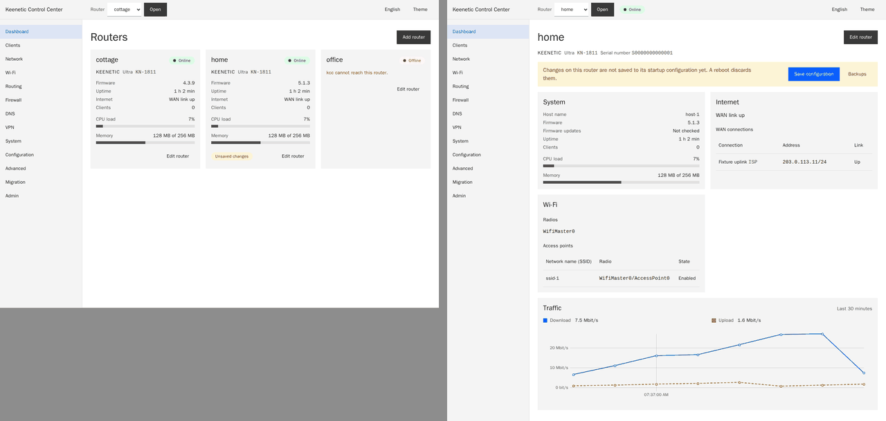
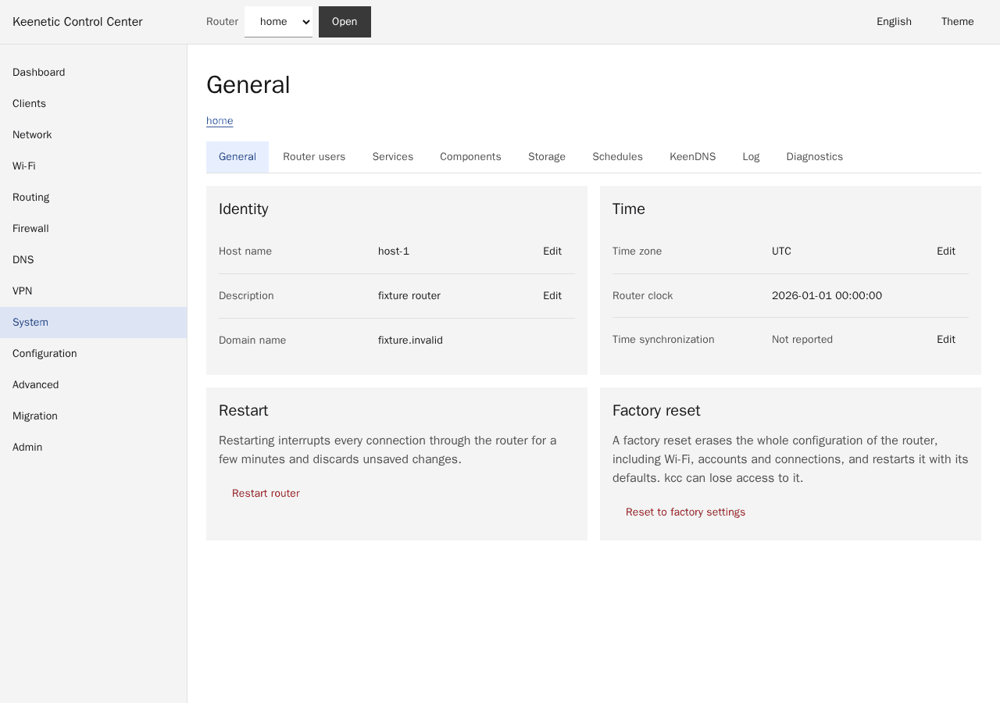
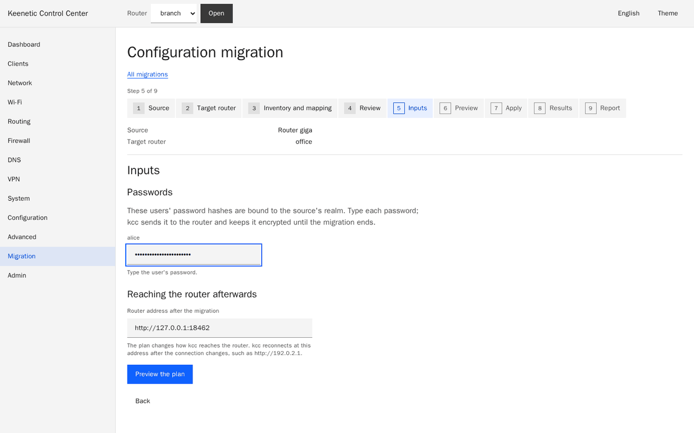

# User guide

This guide covers the kcc Web UI page by page. The UI lives under `/ui/` on the
address `kcc serve` listens on (default `http://127.0.0.1:8443/ui/`). Every page checks
your role: pages and buttons you have no permission for are hidden or answer
"Forbidden", and every change is written to the audit log.

## Common patterns

- **Router switcher.** The masthead's Router menu opens the dashboard of another router.
  Router pages live under `/ui/r/<router>/...`.
- **Side navigation.** On a router's page, Clients, Network, Wi-Fi, Routing, Firewall,
  DNS, VPN and System open that router's page of the section. On other pages they open
  the only router you may read, or a list of the routers you may read to pick from.
- **Changes.** A change dialog sends one validated request through the change workflow:
  kcc backs up the startup configuration, checks nobody else changed the router in the
  meantime, applies the change, reads it back and audits it. The result appears as a
  toast; the "Unsaved" badge in the masthead means the running configuration differs
  from the startup configuration. Nothing is saved until you press Save.
- **Risky changes.** Changes that can cut kcc off from the router (disabling or
  re-zoning the interface or access point kcc reaches the router through, its Wi-Fi
  schedule, firewall rules on it, the MTU, identity, password, "connect via" or default
  route of the internet connection kcc reaches the router through, creating a segment on
  the interface or access point kcc uses, releasing the KeenDNS name kcc uses) ask first on every
  page and run under the router's fail-safe timer, which the change's own permission
  authorizes; nothing is sent before you confirm. When kcc cannot tell which interface
  carries its connection (for example when it reaches the router through a relay or
  address translation), it treats every interface as the one it reaches the router
  through, so these changes ask first and run under the fail-safe timer on any interface;
  the one exception is a bridge whose neighbours in the router's ARP or hotspot records are
  all on other interfaces, which kcc counts as not carrying its connection.
  Rolling the timer back yourself needs
  the Destructive permission. While a fail-safe timer you (or a migration) armed is
  running, a risky change is refused with nothing sent, so that it neither replaces
  nor stops that timer: commit or disarm it first. A router that reports neither a system
  mode kcc knows nor a fail-safe timer refuses risky changes before anything is sent. Deletions ask for confirmation; the most dangerous ones
  need the router or object name typed, and a destructive change from any page asks for
  the router name unless the page already asked for a name.
- **Tables** sort by a column header, filter with the search field and page at the
  bottom. On phones they scroll sideways without a visual cue.
- **Secrets** (Wi-Fi keys, VPN keys, passwords) show only as Set or Not set, and the
  fields that change them are write-only: a dialog asks for the new value twice and
  never shows the stored one. Leaving both fields empty keeps the stored value and sends
  nothing. The new value goes only to the router, never into a page, a toast, the audit
  log (it records field names only) or the server log, and kcc verifies it by reading
  back that the router stores a value, never the value itself (for router account, PPP
  and Wi-Fi passwords it also requires the stored value to have changed, see Network). Reading a stored secret is a separate Reveal action where a page offers one:
  it needs the RevealSecrets permission, is audited whether allowed or not, and shows
  the value only in its own dialog.

## Dashboard and fleet



`/ui/` shows one card per router with its status, model, firmware, support tier and
unsaved state, refreshed live. Admins with ManageRouters add, edit, test and remove
routers here (Add router). The router form takes the name, address, login, sign-in
mode, password or API token, certificate check (verify, or pin one certificate), an
optional read-only polling account, tags and the `test_device` flag. The sign-in mode is
Automatic (the scheme the router offers), ndw2, ndw4, HTTP digest or API token; the
token field appears only for API token and replaces the password. The read-only login
and password are entered together; the poller then signs in with them instead of the
management login, and "Remove read-only login" on the edit form drops both. The pin is
the SHA-256 of the router certificate's public key (SubjectPublicKeyInfo) and applies to
https addresses only. Test connection signs in the way the form says (the chosen mode, with the typed
password or, in mode API token, the typed token), or with the stored credentials when
the field is empty, without storing anything. When a credential file is readable by
other users the page gives the chmod hint without the file's path; the path is in the
server log. Routers defined in
`kcc.toml` are read-only here.

Passwords, tokens and read-only passwords entered in this form are encrypted in the state
directory and are never shown again: an empty field keeps the stored secret, and the
form only says that one is stored. Changing the address, login or certificate check
needs the password (or the token) again and drops the read-only login unless it is
entered again in the same save; switching to API token needs a token and removes the
stored password, switching back needs a password and removes the stored token.
`kcc router add` and `kcc router edit` use the same sealed store for every
credential they take: the password (`--password-file`, `KCC_PASSWORD` or the hidden
prompt), a login token (`--auth token --token-file <file>`) and a read-only polling
login (`--read-login <name> --read-password-file <file>`). The files are input only and
can be deleted afterwards. `KCC_PASSWORD` supplies one secret per command: a command
that needs two secrets without files is refused. An edit seals its new secrets only for
a valid profile, and an edit that fails keeps the previous sealed secrets. Changing a router's address, login or certificate pin needs
its password or token again (`--new-password` or `--new-token`) and drops the read-only
login unless it is given again. Only the `password_file`, `token_file` and `read_password_file` paths in `kcc.toml`
stay under operator control and are read in place. Back up the master
key selected by `KCC_MASTER_KEY_FILE` separately from state; without it, restored sealed
credentials and encrypted backups cannot be opened.

A router's dashboard (`/ui/r/<router>`) shows host name, firmware, memory, internet and
WAN link state, WAN connections, radios and access points, the WAN traffic chart (the
last 30 minutes, kept in memory), the unsaved-changes banner with Save, and the
support-tier notice for documentation-based firmware, and the router's next scheduled
action when `kcc serve` has one. The firmware line says "Update
available" or "Up to date" once kcc has asked the router (`components check-update`, in
the background, at most every six hours per router and only while the router answers
its polls); until then it says "Not checked".

## Clients


`/ui/r/<router>/clients` lists connected and registered clients with filters for
online/offline and wired/wireless. Row actions: register or rename, allow or deny
access, assign a connection policy or schedule, set priority, wake-on-LAN, remove.

## DHCP

`/ui/r/<router>/dhcp` has tabs for pools, static leases, current bindings and ARP
neighbours. You can edit a pool and add a static lease ("Make static" on a binding fills
the form). Removing pools or static leases isn't offered yet.

A pool hands out at most one DNS server: a second one is refused under the DNS field, and
an empty DNS field removes the pool's DNS server (`no ip dhcp pool <name> dns-server`). Add
pool refuses a name the router already has; edit that pool instead.

On the command line, `kcc dhcp pool <name> --begin <ip> --end <ip> --gateway <ip>` creates
or replaces a pool. `--gateway` is required (usually the interface's own address).
Replacing a pool the router already has also needs `--lease-seconds` and `--state`, so
they are not reset to 86400 and `on`; an omitted `--interface` or `--dns` keeps the pool's
own. A second `--dns` is refused with exit code 4.

## Segments

A segment is a separate network kcc builds as one unit: a VLAN, a bridge with its own
address, a DHCP pool, the switch ports and Wi-Fi access point that carry it, and a
connection policy. `/ui/r/<router>/segments` lists the segments kcc created on the
router: bridge, VLAN ID, address, DHCP range, NAT, whether new devices are allowed, Wi-Fi
access point, the ports carrying the VLAN and the connection policy. A segment that lost
some of its objects is marked Incomplete. kcc lists only the segments it created: it
records each one on the router and removes it as a unit, and it cannot tell which objects
belong to a bridge made elsewhere. Your other bridges and VLANs are on the Network page,
which the Segments page links to.

Create segment builds a new one (VLAN, bridge, address, DHCP pool, ports, access point,
policy) step by step, rolling back finished steps, and the failing step when the router
accepted it but the read-back failed, if one fails. A stray description that starts with
`kcc-segment:` but isn't a valid record is skipped, not listed. Delete lists the router
objects that go and the ports that stay (only the segment's VLAN leaves them), and asks
you to type the router's name. It deletes nothing if the segment changed after the
dialog opened. Incomplete segments delete what is left. Deleting needs the same Write
permission as creating.

## Network


The network area has tabs:

- **Interfaces** (`/network`): every interface with state, address and traffic; a
  drawer shows details and a live traffic chart. Bring up or down, set the description
  or security level. Taking down the management interface is a risky change.
- **Internet** (`/internet`): WAN connections with priority order, default route,
  address mode (DHCP or static), MTU, identity and "connect via"; create and delete
  connections. A PPP connection's (PPPoE, L2TP, PPTP) password is set from its settings
  (Edit beside Password). On the connection kcc reaches the router through these are
  risky changes; the password dialog then explains the fail-safe timer and its Apply
  confirms it.
- **Wi-Fi** (`/wifi`): access points and radios; turn an access point on or off, hide
  the SSID, edit settings. The Wi-Fi password is set from an access point's settings
  (Edit beside Wi-Fi password): 8 to 63 characters, checked before anything is sent.

A new password of a router account, a PPP connection or a Wi-Fi access point (Web, MCP
and CLI alike) is verified without reading it: kcc reads the stored, encoded value before
the write and requires it to have changed afterwards. A router that accepts the write but
keeps the old value fails with "verification failed" naming the setting (for example
`interface WifiMaster0/AccessPoint0 authentication wpa-psk`). The stored value of the same
password is always the same, so setting the password it already has fails the same way:
the stored value did not change. When the stored value cannot be read before the write,
nothing is sent. A first password, where none was stored, is checked for presence only.
- **Mesh** (`/mesh`): mesh members with check, update and restart actions.

A dialog or a change that needs a value from the router (the current setting, the
interfaces or schedules to choose from, the names already taken) shows "The router did
not answer" when that read fails; nothing is preselected and nothing is sent. This holds
on the network, routing, NAT and firewall pages alike.

## Routing

The Routing section has tabs for static routes (IPv4 and IPv6, add and remove), the
routing table, and connection policies (create, description, permitted interfaces and
their order, multipath, delete; an empty description clears it). Add route sends the
route in the form the router stores it: the IPv4 network without host bits and every
address in canonical form, so `198.51.100.7` with mask `255.255.255.0` is added as
`198.51.100.0`, and a route the router already has is refused whatever its spelling.
Removing a route runs
a guard: kcc checks that the exact route line is gone from the running configuration, and
if the router clears more than the one route, it puts every static route back from the
running configuration and says so.

## NAT and port forwarding

`/ui/r/<router>/nat` lists port forwards (add, remove), NAT interfaces (add, remove) and
the active connection table, read in pages of 200.

## Firewall


`/ui/r/<router>/firewall` shows the IPv4 access lists with their rules, the interface
bindings and UPnP redirects. You can add, remove, move, enable or disable rules, set a
rule's description or schedule, and bind or unbind a list. A change that touches the
interface kcc reaches the router through is a risky change. IPv6 access lists are
read-only, because no firmware catalog has `ipv6 access-list`.

## DNS


`/ui/r/<router>/dns` has tabs for upstream servers (plain, DNS over TLS, DNS over
HTTPS), filtering (engine, profiles, assignments, intercept), static records, FQDN
lists and DNS routes. Removing upstreams, records, lists, routes or profiles isn't
offered yet.

## VPN

`/ui/r/<router>/vpn` lists VPN client connections (turn on or off, delete) and VPN
servers (service state, address pool, DNS, IPsec; the IPsec rows show the virtual IP of
each crypto map by name). Delete removes VPN client interfaces only; any other interface
is refused. WireGuard connections can be created or imported from a `.conf` file. A
`.conf` problem is reported by line number only, never with text from the file. The ASC
command takes at most 16 values, each sent quoted. The import sends the file's private key, preshared keys
and obfuscation keys to the router and verifies that the router reports each one; a file
without a private key gets one the router generates. kcc reports which fields of the
file it didn't send (address, DNS, ASC). Peers of a WireGuard tunnel are listed and
added on their own page; a peer's preshared key is set in its dialog (left empty, the
peer keeps its key). Client types other than WireGuard have no create form, but their
credentials can be set: the password of an L2TP/IPsec, PPTP or SSTP connection, the
IPsec key of an L2TP/IPsec connection, and the pre-shared key and XAuth password of an
IPsec connection's profile (row actions). On the servers tab, Set pre-shared key sets
the IPsec/IKEv2 server's IKE key, and Set an account's password sets the password a
router account uses with the PPTP/L2TP, SSTP and OpenConnect servers.

## System



`/ui/r/<router>/system/...` has tabs:

- **General**: host name, description, time zone, NTP server, restart, factory reset.
  Host-name, description and time-zone changes are verified by a fresh read. Their
  simulator projection is documentation-derived; the real firmware shape is unconfirmed.
- **Router users**: router accounts and their tags; add (with an optional password),
  set a password, and delete. These are risky changes run under the fail-safe timer.
  kcc refuses to delete the accounts it logs in with (the profile's login and its
  read-only login), to change their passwords or to remove their tags: change such a
  password on the router, then enter it in kcc with Edit router. An API token profile
  names no login, so kcc cannot tell its own account there and refuses every password
  change, tag change and deletion of a router account. When the router cannot be read
  to check whether an account, component, medium or KeenDNS name exists, the change
  answers that the router did not answer and sends nothing.
- **Services**: turn router services on or off. kcc refuses to move, close or redirect the
  HTTP or HTTPS listener that its own router address uses; change it on the router, then
  the address in kcc.
- **Components**: installed components; check for updates, queue installs or
  removals, commit (a background job that reboots the router). The job completes only
  after the router went down and came back with every queued change in place, and fails
  when the router comes back without them or does not restart within 15 minutes.
- **Storage**: attached media; eject; Prepare for Entware (see below). Ejecting or
  initializing the drive Entware runs from asks a second time.
- **Entware**: whether the router can run Entware, its settings, and its drives; the
  guided setup, the SSH access and the packages and services are described under
  [System > Entware](#system--entware) below.
- **Schedules**: create schedules and their actions.
- **KeenDNS**: book or drop a name, set the access level, add proxy entries. The
  current access level and proxy entries aren't readable.
- **Log**: the router log, live, with search and download. With `[logs] enabled` the
  page follows the router's log collector, so viewers add no router requests; otherwise
  all viewers of a router share one reader that asks the router at most every 5 seconds
  and stops when the last viewer leaves.
- **Diagnostics**: ping and traceroute as background jobs with live output and Stop; a
  running diagnostic asks the router for its progress every half second. Only the user who
  started a job, or an admin, can follow or stop it.

### System > Entware

Entware is an optional package system that runs from a drive on the router. The page
(`/ui/r/<router>/system/entware`) starts with whether the router can run it: it cannot
without the router's USB and storage components, or when no Entware installer exists for
its architecture, and the page says which. It then lists the `opkg` and `ext` components,
the architecture, the settings (drive, startup script, time zone, chroot, DNS override)
and the drives. kcc has not yet run any of this on a real router (see
[BACKLOG.md](BACKLOG.md)).

**Drive preparation.** Entware needs a drive with an ext2, ext3 or ext4 filesystem. On
**Storage**, **Prepare for Entware** (the permission `Destructive`, then the router name
typed) wipes a medium the router can initialize and creates a swap and an ext4 partition.
The router does it in the background (the command reference says KeeneticOS 5.01 and
later): reload the page after a
few minutes. `kcc storage initialize <media> --confirm-destructive <router-id>` waits for
the ext4 partition, at most 10 minutes. Ejecting or initializing the drive Entware runs
from asks a second time (`--entware-ok` on the command line; without it exit code 10).

**Guided setup.** Choose a drive (or, with the router's own warning that it is untested,
the internal storage) and Set up Entware. A MIPS router that reports only `mips` asks
which installer to use, `mipsel` or `mips`; kcc refuses the wrong choice. Setup needs
`Destructive`, no unsaved changes and no running fail-safe timer. It runs as a job: it
installs the missing `opkg` and `ext` components (the router restarts), starts the
installer once, follows the installer's five steps in the router log and checks the drive
setting, in at most 15 minutes. The job never saves: it ends by offering Save. The
command line is `kcc entware setup --drive <label>:/ [--arch aarch64|mipsel|mips]
--confirm-destructive <router-id>` (`--drive` takes `<label>:/` or `<uuid>:/` from `kcc
entware status`, or `internal`; anything else is refused with exit code 4 before the
router is asked).

**Settings.** Chroot, time zone and DNS override need `Write`, the startup script and
Remove Entware need `Destructive`. While **chroot** is on, Entware's start scripts run
with `/opt` as their root and kcc refuses every SSH action that contacts the router.
**DNS override** frees the router's DNS port 53 for a DNS server inside Entware and runs under the fail-safe timer:
while it is on, every device at home resolves names only through that server, so nobody
can open websites if it does not run. The page also says when the router's DNS filter
uses the `opkg` engine, which stops with Entware. **Remove Entware** clears the drive
setting; the files stay on the drive. On the command line: `kcc entware set
chroot|dns-override on|off`, `set timezone auto|<name>`, `set initrc <path under /opt/>`
and `kcc entware remove` (`--yes` for dns-override, `--confirm-destructive <router-id>`
for initrc and remove).

**SSH access.** For packages and services kcc signs in to Entware's SSH server with a key
of its own. The section shows once Entware runs from a drive, and only to a role with
`Destructive` on the router (a direct request from any other role gets 403); every action in it asks for the router name (`--confirm-destructive
<router-id>` on the command line, reads included). kcc's outbound policy must admit the
router's address for SSH (`[outbound] allowed_networks`). The enrolment has two steps:

1. **Check router identity** (`kcc entware ssh probe`). kcc connects to the SSH port
   (222 unless you set another; `kcc entware ssh enable --port <n>`), reads the router's
   ed25519 host key without signing in, and shows its `SHA256:` fingerprint and a ticket.
   Compare the fingerprint out of band before you go on: from a trusted computer in the
   router's local network run `ssh -p <port> root@<router>` and read the fingerprint it
   shows (then stop at the password prompt), or `ssh-keyscan -t ed25519 -p <port> <router>
   | ssh-keygen -lf -`, or read it on the router with `dropbearkey -y -f
   /opt/etc/dropbear/dropbear_ed25519_host_key` (or run `ssh-keygen -lf` on a copy of
   `dropbear_ed25519_host_key.pub` from the drive, if the file exists). The ticket is valid for 5 minutes, for one
   attempt, for you and this router and port.
2. **Enrol** (`kcc entware ssh bootstrap --ticket <t> --fingerprint <SHA256:...>`). Tick
   that you confirm the fingerprint and enter the Entware root password; on the command
   line the password comes from `--password-file`, else `KCC_PASSWORD`, else a hidden
   prompt, never from an argument. kcc uses it once to install its key in the router's
   `authorized_keys` and never stores it; from then on kcc signs in with the key only. A
   warning appears when the password is still Entware's default (`keenetic`): change it
   on the router.

The page shows the state: **Not enrolled**, **Pending** (kcc's key is not confirmed yet)
or **Active**, with the pinned fingerprint and who enrolled it. Enrolling an Active router
again, or pinning a changed host key (**Check the new host key**, `kcc entware ssh repin`),
first needs a box ticked (`--yes` on the command line): kcc saves a new key and marks the
enrolment Pending before it contacts the router, so a wrong password or an unreachable
router leaves it Pending and the package and service actions stop until a new check and
enrolment succeed. A host key that differs from the pinned one is refused before any
password is sent, with both fingerprints shown, and audited as
`entware.ssh.hostkey_mismatch`. A change of the router's address clears the pin: check and
enrol again. **Revoke kcc's key** removes kcc's line from the router and then the local
state; **Forget here** (`kcc entware ssh disable`) forgets the key and pin on this side
only, and the router keeps kcc's key line until someone removes it there. **SSH
management** off keeps the enrolment but stops all SSH actions. Deleting a router that
still authorizes kcc's key warns you to revoke it first. Enrolment is Web and CLI only:
MCP can never enrol.

**Packages and services.** Once Active, **Packages** lists installed and upgradable
packages and updates the package lists, installs, removes or upgrades one package.
**Services** lists the init scripts in `/opt/etc/init.d` (named like `S51dropbear`),
shows whether one runs or its log records (masked without `RevealSecrets`), and starts,
stops or restarts one. A package name is lowercase letters, digits and `+ . _ -`, at most
64 characters, and kcc acts only on packages and services the same session listed. Changes
run as jobs and are read back on the router; kcc holds one SSH session per router and
four in all, so a list that waits behind a running change says the router is busy (after
25 seconds), and a change may take up to 10 minutes. On the command line:
`kcc entware packages list|upgradable|update|install|remove|upgrade` (the last three take
a package name) and `kcc entware services list|status|start|stop|restart|log` (all but
`list` take a service name; `log` takes `--lines N`, 1 to 1000, default 50). Every operation
is audited as `entware.ssh.*` with the router, the actor and the outcome, never the
output. The same operations over MCP are the `entware-ssh` toolset
([MCP_TOOLS.md](MCP_TOOLS.md)); [SECURITY.md](SECURITY.md) describes the trust model.

## Configuration and backups

`/ui/r/<router>/config` shows the unsaved state and the fail-safe timer (Save while the
timer is not armed, Commit or Roll back while it is; a Save sent while it is armed is
refused and audited `armed`), names a scheduled action whose change the router has not
saved, and lists the router's backups. You can
back up the startup configuration, upload a configuration file as a backup, download a
backup redacted (or in full with RevealSecrets, audited), compare two backups (secrets
redacted on both sides), delete one, and restore one. Restore offers the migration
wizard, or a raw restore onto the same model: kcc uploads the file, reboots the router,
reconnects and checks the router's checksum. A raw restore has no live progress, and a
backup that changes the management address ends with "the router did not answer".
Backups are pruned by `[backups] keep_last` and `max_age`.

`kcc backup diff <older> <newer>` compares the two configurations command by command, in
order, including changed secrets, and prints the removed and added commands with every
secret replaced by `<redacted>` (JSON: `removed` and `added`); a difference too large to
compare in order is refused with exit 4. `kcc preset delete <id>` is destructive and needs
`--confirm-destructive <id>`. With `--json`, an argument error is the usual
`{"error": {...}}` object on stderr with `"kind": "usage"` and exit code 2.

## Presets and settings copy


`/ui/presets` stores named presets: groups of settings captured from a router, a backup
or an uploaded file, encrypted at rest. Open a preset to see its redacted lines, reveal
them (RevealSecrets, audited), apply it to a router, or delete it. Copy settings
(`/ui/copy`) does the same without storing a preset. Both walk through source, target,
options (Merge or Mirror, WireGuard keys), review, inputs, apply under the fail-safe
timer, then Keep unsaved, Save or Roll back. Unsaved drafts of a new preset live in
memory for an hour and are lost on restart. [MIGRATION.md](MIGRATION.md) explains the
groups and rules.

## Migration wizard



`/ui/migrate` moves a whole configuration onto another router in nine steps: source
(router, backup or file), target, inventory and port, radio and interface mapping,
review of every line with its disposition, inputs (passwords, reconnect address),
preview with downloadable plan and report, apply with live progress and Stop, results
with Commit or Roll back, and the final report. [MIGRATION.md](MIGRATION.md) covers the
rules.

Runs of the migration wizard and of presets and copy settings are kept on the kcc host
under `<state>/migrations/`. Each user keeps at most 10 unfinished runs of each wizard (the
migration wizard, and presets with copy settings); an 11th start is refused with the
reason. A run whose last change is more than a day old counts as abandoned and no longer
as unfinished, and kcc deletes what it sealed for it (the source, the copied settings and
the typed passwords; a migration left that long must be started again). A run, finished
or abandoned, is deleted 30 days after its last change,
with everything kcc kept for it; the deletion happens when the wizard's page is next
opened. An apply that nobody finishes ends when the router's fail-safe timer runs out:
the run then shows that the router rolled the changes back.

## Advanced: command explorer and consoles

`/ui/r/<router>/explorer` searches the router's command catalog for its firmware and
model, shows each command's arguments and runs it with validated input. Background
commands that only read run as jobs; one that changes the router is refused, and its
detail page offers no Execute button. The RCI and CLI consoles send raw requests that are still
validated against the catalog; they need the RawRci permission. Writes go through the
change workflow. In the CLI console an administrator can tick "Send without catalog
validation" for a command the catalog does not know; such a line counts as destructive:
it needs the Destructive permission and the router name typed in the dialog, and runs
under the recovery timer. Answers, the configuration lines of `show running-config` included,
show secrets as `********` unless you hold RevealSecrets on that router. On the CLI,
`kcc show` and `kcc rci` print them as `<redacted>` under the same rule.

## Administration


`/ui/admin` holds:

- **Users**: create accounts, change roles, disable, unlock, delete. The last enabled
  admin can't be removed, and nobody can act on their own account here.
- **Roles**: custom roles with permissions and router-name globs (for example `lab-*`).
  You can grant only roles whose permissions and routers you hold yourself (the CLI's
  `kcc user add` and `kcc apikey create` apply the same rule to the `[cli] role`). The
  permissions ManageNotifications and ManageSchedules open the two pages below; the
  built-in `admin` holds them, `operator` and `viewer` do not, and a custom role gets
  them with their checkboxes.
- **API keys**: create keys for MCP clients (shown once) and revoke them. The "Last
  used" column shows the last MCP tool call with the key, recorded at most once a minute.
  A key name is 1 to 64 lowercase letters, digits, dots, hyphens or underscores. "Expires
  in" (never, 7 days, 30 days, 90 days or 1 year) gives a key an expiry; from then on MCP
  requests with it get HTTP 401, and the "Expires" column flags it as expired until you
  revoke it. `kcc apikey create <name> --role <role> --expires-in <duration>` does the
  same from the command line with any duration from one second to ten years (`12h`,
  `30d`, `1y`); without `--expires-in` a key never expires. `kcc apikey list` shows the
  expiry as Unix seconds and marks expired keys (`--json`: `expires_at`, `expired`).
- **Notifications**: Telegram notifications (ManageNotifications), described below. The
  tab shows only to roles that hold the permission.
- **Scheduled actions**: weekly scheduled actions (ManageSchedules), described below. The
  tab shows only to roles that hold the permission.
- **Audit log**: search, filter and export the hash-chained audit log (ViewAudit). A role
  scoped to some routers sees only those routers' entries; entries that name no router
  (sign-ins, account changes) are shown only to a role scoped to all routers.
- **MCP**: the MCP settings (ManageMcp), described below. The tab shows only to roles
  that hold the permission.
- **Server**: the running configuration summary and catalog versions, with a link to the
  MCP settings.

Your own account page (`/ui/account`) changes your password and language; a password
change signs your other sessions out and keeps the one you made it in. After
`kcc admin init`, or an administrative reset, the first sign-in must change the
password.

Changes made with the CLI (`kcc apikey revoke`, `kcc user disable`, `kcc user passwd`)
reach a running `kcc serve` within about 2 seconds: a revoked key is refused, and the
account's signed-in sessions end when it is disabled or its password is reset; their open
live views end within 5 seconds after that.

### Administration > MCP

`/ui/admin/mcp` changes the `[mcp]` settings while `kcc serve` runs, one section at a
time: **Tools** (toolsets, read-only, destructive tools, result size, local stdio and
its role), **Endpoints** (MCP over HTTP, which listener serves `/mcp`, the dedicated
listener's address, port, public URL and certificate; for a self-signed certificate the
SHA-256 fingerprint and a PEM download), **Sign-in** per listener (API keys are always
on; OAuth and client certificates; `required` only on the dedicated listener),
**kcc sign-in** (token lifetimes and the issuer, or why there is none), **Identity
provider** (issuer, audience, JWKS URL, role claim, claim value and scope to role rows,
signing algorithms, CA bundle upload) and **Client certificates** (CA upload and the role
of a certificate). Under each value the page says where it comes from: an environment
variable or `[mcp] locked` makes it read-only; "Overridden on the Web" offers a reset to
kcc.toml.

A change that reduces safety (destructive tools on, read-only off, turning on a toolset
marked "Reduces safety" (`raw`, `entware-ssh`), stdio on or a stronger stdio role, an
OAuth sign-in method, adding client certificates or dropping `required`, any identity
provider setting, the role of a client certificate, longer token lifetimes, plain HTTP on
the dedicated listener, a non-loopback dedicated listener) asks for your password first;
resetting the toolsets back to kcc.toml never asks. A wrong password counts toward the
sign-in lockout, and a lockout leaves your current session signed in. A role you name must be one whose permissions and routers you hold.
The same holds for the roles a sign-in source hands out: changing the identity provider's
issuer, audience, JWKS URL or role claim, switching a listener to it, or uploading its CA
bundle needs a role that covers every role its mappings name (even mappings from
kcc.toml), and switching a listener to client certificates or uploading the client CA
needs a role that covers `[mcp.auth.mtls] default_role` (`viewer` when unset). The page
refuses the change, before asking for the password, and names the role.
Tool settings apply at once (open MCP sessions get a tightening at their next call, new
sessions get a loosening). Listener and sign-in changes restart the listener they affect:
the page shows "Restarting" and then the outcome; if the new listener cannot start, the
previous one serves again, the settings file stays as it was and the page says why. A
restart of the main listener interrupts the Web UI for at most `server.shutdown_timeout`
plus 10 seconds. Sign-in with another identity provider (`external`) needs the issuer,
audience and JWKS URL of **Identity provider** (see "Use your identity provider" below);
without them, or with a JWKS host on a private address kcc.toml does not admit, the restart
reverts with the reason. kcc sign-in needs an issuer; without
one (no DNS name in `web.public_url` and a non-loopback main listener, or the Web UI off)
the page refuses it and says why. CA files are uploaded as PEM files of at most 64 KiB
holding one to ten CA certificates; nothing on the page takes a file path. Replacing the
client CA while a listener uses client certificates, or the identity provider's CA bundle
while a listener signs in with the provider, asks for your password and restarts those
listeners; if they cannot start with the new file, the previous file is put back.

### Connect an MCP client with your kcc account

When an administrator sets **Sign-in > OAuth** of a listener to **kcc** on
Administration > MCP, MCP clients sign in with a kcc account instead of an API key. Add the
server with exactly the URL the MCP page shows for that listener (for example
`http://localhost:8443/mcp`). The loopback spellings of the same port (`127.0.0.1`,
`localhost`, `[::1]`) and the listener's public URL are accepted too; any other address is
refused as an unknown resource:

```text
claude mcp add --transport http kcc http://localhost:8443/mcp
```

The client registers itself, then opens your browser on kcc's sign-in page. Sign in with
your kcc account; the consent page then shows the name the client gave (marked
**unverified**: any program can choose any name), the host the browser returns to, your
account and your role. **Allow** only when you started this connection. The client then
calls MCP with your account's current role: a role change, a disabled account, a password
change or a revoked connection applies to its next call. An account that must change its
password is sent to the account page first and cannot connect clients until it has.

With kcc's own or another private CA on an `https` listener, Node-based clients such as
Claude Code need the CA: `NODE_EXTRA_CA_CERTS=/path/to/ca.pem claude`. Native clients
(Claude Code, Codex, Cursor, VS Code) sign in this way; browser-based clients, such as the
MCP Inspector's web UI, are refused at `/oauth/token` by the server's Origin check.

### Connections and clients

Administration > MCP has a second tab, **Connections** (`/ui/admin/mcp/connections`,
permission ManageMcp). It lists the MCP clients signed in with a kcc account by account:
the client's name (unverified), the host the browser returns to, when it connected, when it
last got a token and the MCP server it is for. **Revoke** ends one connection, **Revoke
all** every connection of an account (type the account name to confirm); the client's very
next MCP call is refused and its tokens can no longer be refreshed. The account and its
role are not changed here, and no token is ever shown.

**Registered clients** lists every client with its redirect URIs, who registered it and
its connections, and how many of the 50 places are taken. **Delete** removes a client and
revokes its connections. **Register a client** is for an MCP client that cannot register
itself: a name and one to five redirect URIs (http to `127.0.0.1`, `[::1]` or `localhost`,
https, or an app scheme such as `com.example.app:/callback`), under the same rules and the
same limit as clients that register themselves; a client registered here is never removed
for being unused.

The same from the command line, with the `[cli] role` holding ManageMcp:

```text
kcc mcp settings show
kcc mcp connections list
kcc mcp connections revoke <grant-id> --confirm-destructive <grant-id>
kcc mcp connections revoke-account <user> --confirm-destructive <user>
kcc mcp clients list
kcc mcp clients delete <client-id> --confirm-destructive <client-id>
```

`kcc mcp settings show` prints every `[mcp]` value the MCP page manages with where it comes
from (environment, kcc.toml locked, Web, kcc.toml, default); `--json` prints one document.
A revocation or deletion needs `--confirm-destructive` naming what goes, or that name typed
on a terminal; `--yes` does not stand in for it. Exit codes: 10 without ManageMcp or the
confirmation, 4 for a malformed id, 2 when there is nothing to revoke or delete. A running
`kcc serve` applies them at the client's next MCP call.
### Use your identity provider

A listener whose **Sign-in > OAuth** is **External identity provider** accepts access
tokens of your own OpenID Connect provider (Keycloak, Authentik and similar) besides API
keys. kcc is only the resource server: the provider registers the MCP clients, signs the
users in and asks for their consent, and kcc checks each token and maps it to a kcc role.
The protected-resource metadata of the listener names the provider as the authorization
server, so MCP clients go there to sign in.

A Keycloak example (realm `home`, kcc reachable as `https://kcc.example.net`):

1. **Client registration.** Under Realm settings > Client registration, allow the MCP
   clients to register themselves (anonymous dynamic client registration, limited by the
   trusted-hosts policy to the hosts your clients run on), or create a public client with
   the client's redirect URI by hand.
2. **Audience.** Add a client scope with an **Audience** mapper whose included custom
   audience is `kcc-mcp`, and make it a default scope of the MCP clients. Every token kcc
   accepts must name this audience.
3. **Groups.** Add a **Group Membership** mapper (claim name `groups`, full group path
   off) to the same scope, and put the users in groups such as `kcc-admins`.
4. **Signing key.** kcc accepts the algorithms you list; an `ES256` (or `EdDSA`) realm key
   is a good choice.

On Administration > MCP, **Identity provider**:

- **Issuer**: `https://keycloak.example.net/realms/home` (exactly as the provider writes
  it into `iss`; a bare host gains a trailing `/`);
- **Audience**: `kcc-mcp`;
- **JWKS URL**: `https://keycloak.example.net/realms/home/protocol/openid-connect/certs`;
- **Role claim**: `groups`, with the rows `kcc-admins` -> `operator` and so on (or leave
  the role claim empty and map scopes to roles);
- **Signing algorithms**: `ES256`;
- **CA bundle**: upload the provider's CA when its certificate is not from a public CA.

Then set **Sign-in > OAuth** of the listener to **External identity provider**. A mapped
role must be one whose permissions and routers you hold, and so must every role already
mapped when you change the provider, switch a listener to it or upload its CA bundle; a
token without a mapped group or
scope, for another audience or issuer, expired, without a subject, or signed with another
algorithm or key is refused. A provider on a private, loopback or link-local address is
refused unless `[mcp.auth.oidc] ssrf_allow_hosts` or `ssrf_allow_cidrs` in kcc.toml admit
it (the Web cannot set them). The audit log names such a caller `oidc:<preferred_username>`
(or its subject), with characters other than letters, digits and `-._@` written as `%XX`.

### Client certificates

An MCP listener with TLS can admit clients by a TLS client certificate instead of a key or
a sign-in. kcc does not issue certificates: bring a CA you run (or an existing one) and
the certificates it signs.

1. Make sure the listener has TLS: the `[server]` certificate for the main listener, or
   the dedicated listener's `tls` (`main` or `self_signed`; plain `none` cannot ask for
   certificates).
2. On Administration > MCP, **Client certificates**, upload the CA as a PEM file (at most
   64 KiB, one to ten CA certificates, nothing else). The page lists the stored
   certificates' subjects. Choose the **Role of a client certificate** (`[mcp.auth.mtls]
   default_role`, `viewer` when unset): it must be a role whose permissions and routers you
   hold.
3. Under **Sign-in**, set **Main listener client certificates** or **Dedicated listener
   client certificates** to **Optional** (a certificate signs in, other clients still use
   an API key or OAuth) or, on the dedicated listener only, **Required** (the TLS handshake refuses a client without a
   certificate from this CA, API key holders included). The listener restarts and kcc
   checks that it enforces the rule; if it does not, the previous settings serve again.
4. Point the MCP client at the listener's `/mcp` URL with its certificate and key.

kcc names the caller after the certificate's first common name (else its first DNS name;
the name may hold only letters, digits and `-._@`, else the certificate signs nobody in)
and audits it as `mtls:<name>`. A client
that sends both a certificate and a key is treated as the certificate. Revocation uses the
CRLs the CA and the certificate name; a certificate whose CRLs cannot be fetched is
refused, and one with no CRL distribution point under a CA without one is never checked.
Replacing the CA while a listener uses client certificates asks for your password and
restarts those listeners. Desktop MCP clients rarely support client certificates. On the
main listener, which also serves this Web UI, **Optional** can make a browser that holds
a certificate from this CA show a certificate picker, and a browser that offers a
certificate from another CA is refused at the handshake, the sign-in page included.

### Administration > Notifications

`/ui/admin/notifications` sets up the Telegram bot kcc sends notifications through.

- **Status**: whether the notifier runs in this kcc process (without it, changes apply
  at the next start), how many messages wait or were dropped, whether a bot token is set
  and since when, and the Bot API address. The address comes from
  `[notify.telegram] api_url` in `kcc.toml` and cannot be changed on the page. When
  Telegram refuses the token, a banner says so and nothing is sent until a new token is
  saved.
- **Bot token**: paste the token BotFather gave you and save it. kcc seals it with its
  master key and never shows it again; the page only says that a token is set. **Remove
  token** asks first, then deletes it.
- **Settings**: turn sending on or off, pick the message language (or the server's
  default), choose whether messages name clients by name and MAC address instead of a
  pseudonym (client IP addresses are never sent), and tick the events to send.
- **Chats**: add a chat by its numeric id or public `@username`, with a label, an
  optional forum topic id and a "send without sound" switch; up to 10 chats. A chat
  Telegram refused shows why; remove it and add it again once the bot is back in it.
- **Test message**: sends one message to the chosen chat and shows whether it was sent
  or why not.

Every change is audited (`web.notify_settings`, `web.notify_token`,
`web.notify_chat_add`, `web.notify_chat_remove`, `web.notify_test`); the entries name a
chat by its label and never carry the token or a chat id.

The settings and chats are kept in `notify.json` in the state directory, the delivery
state (when the token was set or refused, chats Telegram refused, the firmware version
already announced per router) in `notify_state.json`, and the token itself sealed in
`notify/telegram.token.sealed`. Messages report what the `kcc serve` process itself sees:
a change or audit entry made by the CLI or `kcc mcp stdio` is not announced.

`kcc notify` does the same without the Web UI, under the same permission (the `[cli] role`
needs ManageNotifications) and with the same checks:

- `kcc notify show` prints the settings, whether a token is set and since when, whether
  Telegram refused it, and the chats with any that Telegram disabled (`--json` for a
  document; it never contains the token).
- `kcc notify enable|disable`, `kcc notify events <list|default>` (a comma-separated list
  such as `router_down_up,job_failed`), `kcc notify locale <tag|default>` and
  `kcc notify client-details on|off` change the settings.
- `kcc notify token` reads the token from `--file <path>` (readable by its owner only),
  `--password-file`, `KCC_PASSWORD` or a hidden prompt, never from an argument;
  `kcc notify token --clear` removes it.
- `kcc notify chat add <id> --label <text> [--thread <n>] [--silent]` and
  `kcc notify chat remove <id>` edit the chats.
- `kcc notify test [--chat <id>]` sends one test message from the command itself (to the
  first chat unless `--chat` is given), with the `[notify.telegram]` settings of its
  `kcc.toml`. On failure it exits with code 6 and names the class (`no_token`,
  `token_rejected`, `chat_refused`, `rate_limited`, `unreachable`, `rejected`); a refused
  token or chat is recorded as the running notifier records it.

```bash kcc-doc-test
kcc notify chat add -1001234567890 --label Family --silent
kcc notify events router_down_up,change_failed,job_failed
kcc notify show
```

The audit actions are `cli.notify_settings`, `cli.notify_token`, `cli.notify_chat_add`,
`cli.notify_chat_remove` and `cli.notify_test`, with the parameters of their Web
counterparts. A running `kcc serve` picks the changes up within about 2 seconds.

### Scheduled actions from the command line

`kcc scheduled` manages the weekly scheduled actions without the Web UI. Every command
needs ManageSchedules for the `[cli] role`; a schedule also needs the permissions of its
action on its router (policy switch and backup `Write`, reboot `Destructive`, preset
`Read`, `Migrate`, `Write` and `Save`, plus `Read` and `Migrate` on the preset's source
router). Scheduled changes are never saved: a router restart undoes them.

- `kcc scheduled list` and `kcc scheduled show <id>` print the schedules the role sees,
  with the next run in the schedule's time zone; `show` adds the last runs (`--json` for
  a document).
- `kcc scheduled add --router <id> --name <text> --days mon,tue,... --at HH:MM
  [--tz <zone>]` with exactly one action: `--policy-switch --mac <mac> --policy <name>`,
  `--preset <id> [--ack-documentation-tier]`, `--backup` or `--reboot`. The zone
  defaults to `[schedules] default_timezone`. Before anything is stored, kcc checks the
  router as the Web page does: the client must be registered and the policy must exist;
  a preset must plan without input, management or WireGuard private-key lines. A policy
  switch or preset needs `--yes` (or a "yes" on the terminal), a reboot
  `--confirm-destructive <router-id>`.
- `kcc scheduled edit <id>` takes the same options (each optional; `--router` moves the
  schedule) and runs the same check and confirmation.
- `kcc scheduled pause <id>`, `kcc scheduled resume <id>` (checked again) and
  `kcc scheduled delete <id>`. Adding, editing and resuming make the CLI user
  (`cli:<user>`) the owner whose authority later runs use.
- `kcc scheduled run-now <id>` runs the schedule once in this process, as its owner,
  with the same confirmation; the run is recorded without a slot and audited as
  `schedule.run` requested by `cli:<user>`. It sends no Telegram message (a running
  `kcc serve` shows the run in its ledger), and a busy router ends it at once with exit
  code 5 instead of being tried again. The CLI never starts the scheduler: slots run only
  in `kcc serve`.

A refused check or a run that did not succeed prints the reason and exits with a code
that follows it: 10 for `forbidden`, `firmware` and `documentation_tier`; 5 for
`router_busy`; 4 for `client_unknown`, `policy_unknown`, `preset_unavailable`,
`not_ready`, `management_lines` and `wireguard_key`; 6 for the rest, including a router
that could not be read.

```bash kcc-doc-test
kcc router add home --url "$ROUTER_URL" --login admin --password-file router.pw
kcc scheduled add --router home --name "Nightly backup" --days mon,thu --at 03:30 --backup
kcc scheduled list
```

The audit actions are `cli.schedule_add`, `cli.schedule_edit`, `cli.schedule_pause`,
`cli.schedule_resume` and `cli.schedule_delete`, with the parameters `id`, `action`
(the action kind) and `router`; never a client or a policy. A running `kcc serve` picks
the changes up within about 2 seconds.

### Administration > Scheduled actions

`/ui/admin/scheduled` lists the weekly scheduled actions on the routers your role covers:
name, router, days, time and time zone, what the action does, its owner, whether it is
active or paused (and why), the next run in the schedule's time zone and the last run's
result. A schedule does one of four things: put a registered client under an existing
connection policy, apply a stored preset (Merge only), back up the startup configuration,
or restart the router. Scheduled changes are never saved: a router restart undoes them.

- **Add scheduled action** opens a dialog: a name (unique on the router), the router, the
  days, the hour and minute, and an IANA time zone (suggested from kcc's own time zone
  data, starting with `[schedules] default_timezone`). For a policy switch it lists the
  router's registered clients and its policies; when kcc cannot read the router it says
  so and the other actions stay available. For a preset it lists the presets you may
  apply and, for a router whose firmware line is only documentation-based (or unknown),
  asks you to acknowledge that. A restart needs the router's name typed.
- kcc checks the schedule with the running scheduler before storing it (your permissions,
  the client and the policy on the router, or the preset's eligibility); a refusal is
  shown in the dialog. You need ManageSchedules plus the action's permissions on the
  router: Write for a policy switch or a backup, Destructive for a restart, and Read,
  Migrate, Write and Save for a preset (plus Read and Migrate on the preset's source
  router). Each router holds at most 64 schedules, 256 in total.
- **Edit** and **Resume** make you the schedule's owner; every run uses its owner's
  permissions at that time. **Pause** stops the slots until a resume; **Delete** asks
  first and removes the schedule with its run history.
- **Run now** asks first (a restart needs the router's name typed) and starts the run in
  the background with your permissions checked besides the owner's; its result shows
  under "Last run" and in the Telegram message. A run-now is never retried: on a router
  busy with another change it ends skipped (`router_busy`).

The schedules are kept in `schedules.json` in the state directory; every run is recorded in
`schedule_runs.json` (the last 20 per schedule) before it starts, which is what keeps a slot
from running twice. A slot that is more than 2 minutes late is skipped and reported, and
a router busy with another change is tried again every minute for 10 minutes.

Schedules run only in `kcc serve`. Without it the page says so, and only lists, pauses
and deletes them. Every change is audited (`web.schedule_create`, `web.schedule_update`,
`web.schedule_pause`, `web.schedule_resume`, `web.schedule_delete`,
`web.schedule_run_now`) with the schedule id, the action kind and the router only; a
refusal is audited with its code.

A router's dashboard names its next scheduled action ("Next scheduled action: <name>,
<time>"). While a scheduled policy switch or preset left changes the router has not saved,
the router's configuration page says "Unsaved change from scheduled action <name> at
<time>; a router restart undoes it", as long as the router's configuration checksum is
the one the run recorded.

## Metrics

The Web UI doesn't chart Prometheus metrics. Enable `[metrics]` and use the Grafana
dashboard in `deploy/monitoring/`; see [MONITORING.md](MONITORING.md).

## Language and theme

The masthead's language menu offers English, Russian, Ukrainian, German, Belarusian and
Kazakh; the theme menu offers light, dark and system. Both are stored in cookies set by
the page's JavaScript, so without JavaScript they do nothing. When you're signed in, the
language menu also saves the language to your account, as the account page does, and
every next page uses it. The sign-in page follows the cookie and shows only these two
menus. See [I18N.md](I18N.md).
