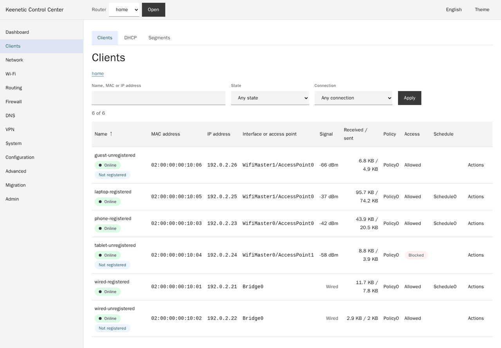

# User guide

This guide covers the kcc Web UI page by page. The UI lives under `/ui/` on the
address `kcc serve` listens on (default `http://127.0.0.1:8443/ui/`). Every page checks
your role: pages and buttons you have no permission for are hidden or answer
"Forbidden", and every change is written to the audit log.

## Common patterns

- **Router switcher.** The masthead's Router menu opens the dashboard of another router.
  Router pages live under `/ui/r/<router>/...`.
- **Side navigation.** On a router's page, Clients, Network, Wi-Fi, Routing, Firewall,
  DNS, VPN and System open that router's page of the section. On other pages they open
  the only router you may read, or a list of the routers you may read to pick from.
- **Changes.** A change dialog sends one validated request through the change workflow:
  kcc backs up the startup configuration, checks nobody else changed the router in the
  meantime, applies the change, reads it back and audits it. The result appears as a
  toast; the "Unsaved" badge in the masthead means the running configuration differs
  from the startup configuration. Nothing is saved until you press Save.
- **Risky changes.** Changes that can cut kcc off from the router (disabling or
  re-zoning the interface or access point kcc reaches the router through, its Wi-Fi
  schedule, firewall rules on it, the MTU, identity, password, "connect via" or default
  route of the internet connection kcc reaches the router through, creating a segment on
  the interface or access point kcc uses, releasing the KeenDNS name kcc uses) ask first on every
  page and run under the router's fail-safe timer, which the change's own permission
  authorizes; nothing is sent before you confirm. When kcc cannot tell which interface
  carries its connection (for example when it reaches the router through a relay or
  address translation), it treats every interface as the one it reaches the router
  through, so these changes ask first and run under the fail-safe timer on any interface;
  the one exception is a bridge whose neighbours in the router's ARP or hotspot records are
  all on other interfaces, which kcc counts as not carrying its connection.
  Rolling the timer back yourself needs
  the Destructive permission. While a fail-safe timer you (or a migration) armed is
  running, a risky change is refused with nothing sent, so that it neither replaces
  nor stops that timer: commit or disarm it first. A router that reports neither a system
  mode kcc knows nor a fail-safe timer refuses risky changes before anything is sent. Deletions ask for confirmation; the most dangerous ones
  need the router or object name typed, and a destructive change from any page asks for
  the router name unless the page already asked for a name.
- **Tables** sort by a column header, filter with the search field and page at the
  bottom. On phones they scroll sideways without a visual cue.
- **Secrets** (Wi-Fi keys, VPN keys, passwords) show only as Set or Not set, and the
  fields that change them are write-only: a dialog asks for the new value twice and
  never shows the stored one. Leaving both fields empty keeps the stored value and sends
  nothing. The new value goes only to the router, never into a page, a toast, the audit
  log (it records field names only) or the server log, and kcc verifies it by reading
  back that the router stores a value, never the value itself (for router account, PPP
  and Wi-Fi passwords it also requires the stored value to have changed, see Network). Reading a stored secret is a separate Reveal action where a page offers one:
  it needs the RevealSecrets permission, is audited whether allowed or not, and shows
  the value only in its own dialog.

## Dashboard and fleet

`/ui/` shows one card per router with its status, model, firmware, support tier and
unsaved state, refreshed live. Admins with ManageRouters add, edit, test and remove
routers here (Add router). The router form takes the name, address, login, sign-in
mode, password or API token, certificate check (verify, or pin one certificate), an
optional read-only polling account, tags and the `test_device` flag. The sign-in mode is
Automatic (the scheme the router offers), ndw2, ndw4, HTTP digest or API token; the
token field appears only for API token and replaces the password. The read-only login
and password are entered together; the poller then signs in with them instead of the
management login, and "Remove read-only login" on the edit form drops both. The pin is
the SHA-256 of the router certificate's public key (SubjectPublicKeyInfo) and applies to
https addresses only. Test connection signs in the way the form says (the chosen mode, with the typed
password or, in mode API token, the typed token), or with the stored credentials when
the field is empty, without storing anything. When a credential file is readable by
other users the page gives the chmod hint without the file's path; the path is in the
server log. Routers defined in
`kcc.toml` are read-only here.

Passwords, tokens and read-only passwords entered in this form are encrypted in the state
directory and are never shown again: an empty field keeps the stored secret, and the
form only says that one is stored. Changing the address, login or certificate check
needs the password (or the token) again and drops the read-only login unless it is
entered again in the same save; switching to API token needs a token and removes the
stored password, switching back needs a password and removes the stored token.
`kcc router add` and `kcc router edit` use the same sealed store for every
credential they take: the password (`--password-file`, `KCC_PASSWORD` or the hidden
prompt), a login token (`--auth token --token-file <file>`) and a read-only polling
login (`--read-login <name> --read-password-file <file>`). The files are input only and
can be deleted afterwards. `KCC_PASSWORD` supplies one secret per command: a command
that needs two secrets without files is refused. An edit seals its new secrets only for
a valid profile, and an edit that fails keeps the previous sealed secrets. Changing a router's address, login or certificate pin needs
its password or token again (`--new-password` or `--new-token`) and drops the read-only
login unless it is given again. Only the `password_file`, `token_file` and `read_password_file` paths in `kcc.toml`
stay under operator control and are read in place. Back up the master
key selected by `KCC_MASTER_KEY_FILE` separately from state; without it, restored sealed
credentials and encrypted backups cannot be opened.

A router's dashboard (`/ui/r/<router>`) shows host name, firmware, memory, internet and
WAN link state, WAN connections, radios and access points, the WAN traffic chart (the
last 30 minutes, kept in memory), the unsaved-changes banner with Save, and the
support-tier notice for documentation-based firmware. The firmware line says "Update
available" or "Up to date" once kcc has asked the router (`components check-update`, in
the background, at most every six hours per router and only while the router answers
its polls); until then it says "Not checked".

## Clients

`/ui/r/<router>/clients` lists connected and registered clients with filters for
online/offline and wired/wireless. Row actions: register or rename, allow or deny
access, assign a connection policy or schedule, set priority, wake-on-LAN, remove.

## DHCP

`/ui/r/<router>/dhcp` has tabs for pools, static leases, current bindings and ARP
neighbours. You can edit a pool and add a static lease ("Make static" on a binding fills
the form). Removing pools or static leases isn't offered yet.

A pool hands out at most one DNS server: a second one is refused under the DNS field, and
an empty DNS field removes the pool's DNS server (`no ip dhcp pool <name> dns-server`). Add
pool refuses a name the router already has; edit that pool instead.

On the command line, `kcc dhcp pool <name> --begin <ip> --end <ip> --gateway <ip>` creates
or replaces a pool. `--gateway` is required (usually the interface's own address).
Replacing a pool the router already has also needs `--lease-seconds` and `--state`, so
they are not reset to 86400 and `on`; an omitted `--interface` or `--dns` keeps the pool's
own. A second `--dns` is refused with exit code 4.

## Segments

`/ui/r/<router>/segments` lists the segments kcc created on the router: bridge, VLAN ID,
address, DHCP range, NAT, whether new devices are allowed, Wi-Fi access point, the ports
carrying the VLAN and the connection policy. A segment that lost some of its objects is
marked Incomplete. Segments made outside kcc aren't listed; their bridges and VLANs are
on the Network page.

Create segment builds a new one (VLAN, bridge, address, DHCP pool, ports, access point,
policy) step by step, rolling back finished steps, and the failing step when the router
accepted it but the read-back failed, if one fails. A stray description that starts with
`kcc-segment:` but isn't a valid record is skipped, not listed. Delete lists the router
objects that go and the ports that stay (only the segment's VLAN leaves them), and asks
you to type the router's name. It deletes nothing if the segment changed after the
dialog opened. Incomplete segments delete what is left. Deleting needs the same Write
permission as creating.

## Network

The network area has tabs:

- **Interfaces** (`/network`): every interface with state, address and traffic; a
  drawer shows details and a live traffic chart. Bring up or down, set the description
  or security level. Taking down the management interface is a risky change.
- **Internet** (`/internet`): WAN connections with priority order, default route,
  address mode (DHCP or static), MTU, identity and "connect via"; create and delete
  connections. A PPP connection's (PPPoE, L2TP, PPTP) password is set from its settings
  (Edit beside Password). On the connection kcc reaches the router through these are
  risky changes; the password dialog then explains the fail-safe timer and its Apply
  confirms it.
- **Wi-Fi** (`/wifi`): access points and radios; turn an access point on or off, hide
  the SSID, edit settings. The Wi-Fi password is set from an access point's settings
  (Edit beside Wi-Fi password): 8 to 63 characters, checked before anything is sent.

A new password of a router account, a PPP connection or a Wi-Fi access point (Web, MCP
and CLI alike) is verified without reading it: kcc reads the stored, encoded value before
the write and requires it to have changed afterwards. A router that accepts the write but
keeps the old value fails with "verification failed" naming the setting (for example
`interface WifiMaster0/AccessPoint0 authentication wpa-psk`). The stored value of the same
password is always the same, so setting the password it already has fails the same way:
the stored value did not change. When the stored value cannot be read before the write,
nothing is sent. A first password, where none was stored, is checked for presence only.
- **Mesh** (`/mesh`): mesh members with check, update and restart actions.

A dialog or a change that needs a value from the router (the current setting, the
interfaces or schedules to choose from, the names already taken) shows "The router did
not answer" when that read fails; nothing is preselected and nothing is sent. This holds
on the network, routing, NAT and firewall pages alike.

## Routing

The Routing section has tabs for static routes (IPv4 and IPv6, add and remove), the
routing table, and connection policies (create, description, permitted interfaces and
their order, multipath, delete; an empty description clears it). Add route sends the
route in the form the router stores it: the IPv4 network without host bits and every
address in canonical form, so `198.51.100.7` with mask `255.255.255.0` is added as
`198.51.100.0`, and a route the router already has is refused whatever its spelling.
Removing a route runs
a guard: kcc checks that the exact route line is gone from the running configuration, and
if the router clears more than the one route, it puts every static route back from the
running configuration and says so.

## NAT and port forwarding

`/ui/r/<router>/nat` lists port forwards (add, remove), NAT interfaces (add, remove) and
the active connection table, read in pages of 200.

## Firewall

`/ui/r/<router>/firewall` shows the IPv4 access lists with their rules, the interface
bindings and UPnP redirects. You can add, remove, move, enable or disable rules, set a
rule's description or schedule, and bind or unbind a list. A change that touches the
interface kcc reaches the router through is a risky change. IPv6 access lists are
read-only, because no firmware catalog has `ipv6 access-list`.

## DNS

`/ui/r/<router>/dns` has tabs for upstream servers (plain, DNS over TLS, DNS over
HTTPS), filtering (engine, profiles, assignments, intercept), static records, FQDN
lists and DNS routes. Removing upstreams, records, lists, routes or profiles isn't
offered yet.

## VPN

`/ui/r/<router>/vpn` lists VPN client connections (turn on or off, delete) and VPN
servers (service state, address pool, DNS, IPsec; the IPsec rows show the virtual IP of
each crypto map by name). Delete removes VPN client interfaces only; any other interface
is refused. WireGuard connections can be created or imported from a `.conf` file. A
`.conf` problem is reported by line number only, never with text from the file. The ASC
command takes at most 16 values, each sent quoted. The import sends the file's private key, preshared keys
and obfuscation keys to the router and verifies that the router reports each one; a file
without a private key gets one the router generates. kcc reports which fields of the
file it didn't send (address, DNS, ASC). Peers of a WireGuard tunnel are listed and
added on their own page; a peer's preshared key is set in its dialog (left empty, the
peer keeps its key). Client types other than WireGuard have no create form, but their
credentials can be set: the password of an L2TP/IPsec, PPTP or SSTP connection, the
IPsec key of an L2TP/IPsec connection, and the pre-shared key and XAuth password of an
IPsec connection's profile (row actions). On the servers tab, Set pre-shared key sets
the IPsec/IKEv2 server's IKE key, and Set an account's password sets the password a
router account uses with the PPTP/L2TP, SSTP and OpenConnect servers.

## System

`/ui/r/<router>/system/...` has tabs:

- **General**: host name, description, time zone, NTP server, restart, factory reset.
  Host-name, description and time-zone changes are verified by a fresh read. Their
  simulator projection is documentation-derived; the real firmware shape is unconfirmed.
- **Router users**: router accounts and their tags; add (with an optional password),
  set a password, and delete. These are risky changes run under the fail-safe timer.
  kcc refuses to delete the accounts it logs in with (the profile's login and its
  read-only login), to change their passwords or to remove their tags: change such a
  password on the router, then enter it in kcc with Edit router. An API token profile
  names no login, so kcc cannot tell its own account there and refuses every password
  change, tag change and deletion of a router account. When the router cannot be read
  to check whether an account, component, medium or KeenDNS name exists, the change
  answers that the router did not answer and sends nothing.
- **Services**: turn router services on or off. kcc refuses to move, close or redirect the
  HTTP or HTTPS listener that its own router address uses; change it on the router, then
  the address in kcc.
- **Components**: installed components; check for updates, queue installs or
  removals, commit (a background job that reboots the router). The job completes only
  after the router went down and came back with every queued change in place, and fails
  when the router comes back without them or does not restart within 15 minutes.
- **Storage**: attached media; eject.
- **Schedules**: create schedules and their actions.
- **KeenDNS**: book or drop a name, set the access level, add proxy entries. The
  current access level and proxy entries aren't readable.
- **Log**: the router log, live, with search and download. With `[logs] enabled` the
  page follows the router's log collector, so viewers add no router requests; otherwise
  all viewers of a router share one reader that asks the router at most every 5 seconds
  and stops when the last viewer leaves.
- **Diagnostics**: ping and traceroute as background jobs with live output and Stop; a
  running diagnostic asks the router for its progress every half second. Only the user who
  started a job, or an admin, can follow or stop it.

## Configuration and backups

`/ui/r/<router>/config` shows the unsaved state and the fail-safe timer (Save while the
timer is not armed, Commit or Roll back while it is; a Save sent while it is armed is
refused and audited `armed`), and lists the router's backups. You can
back up the startup configuration, upload a configuration file as a backup, download a
backup redacted (or in full with RevealSecrets, audited), compare two backups (secrets
redacted on both sides), delete one, and restore one. Restore offers the migration
wizard, or a raw restore onto the same model: kcc uploads the file, reboots the router,
reconnects and checks the router's checksum. A raw restore has no live progress, and a
backup that changes the management address ends with "the router did not answer".
Backups are pruned by `[backups] keep_last` and `max_age`.

`kcc backup diff <older> <newer>` compares the two configurations command by command, in
order, including changed secrets, and prints the removed and added commands with every
secret replaced by `<redacted>` (JSON: `removed` and `added`); a difference too large to
compare in order is refused with exit 4. `kcc preset delete <id>` is destructive and needs
`--confirm-destructive <id>`. With `--json`, an argument error is the usual
`{"error": {...}}` object on stderr with `"kind": "usage"` and exit code 2.

## Presets and settings copy

`/ui/presets` stores named presets: groups of settings captured from a router, a backup
or an uploaded file, encrypted at rest. Open a preset to see its redacted lines, reveal
them (RevealSecrets, audited), apply it to a router, or delete it. Copy settings
(`/ui/copy`) does the same without storing a preset. Both walk through source, target,
options (Merge or Mirror, WireGuard keys), review, inputs, apply under the fail-safe
timer, then Keep unsaved, Save or Roll back. Unsaved drafts of a new preset live in
memory for an hour and are lost on restart. [MIGRATION.md](MIGRATION.md) explains the
groups and rules.

## Migration wizard

`/ui/migrate` moves a whole configuration onto another router in nine steps: source
(router, backup or file), target, inventory and port, radio and interface mapping,
review of every line with its disposition, inputs (passwords, reconnect address),
preview with downloadable plan and report, apply with live progress and Stop, results
with Commit or Roll back, and the final report. [MIGRATION.md](MIGRATION.md) covers the
rules.

Runs of the migration wizard and of presets and copy settings are kept on the kcc host
under `<state>/migrations/`. Each user keeps at most 10 unfinished runs of each wizard (the
migration wizard, and presets with copy settings); an 11th start is refused with the
reason. A run whose last change is more than a day old counts as abandoned and no longer
as unfinished, and kcc deletes what it sealed for it (the source, the copied settings and
the typed passwords; a migration left that long must be started again). A run, finished
or abandoned, is deleted 30 days after its last change,
with everything kcc kept for it; the deletion happens when the wizard's page is next
opened. An apply that nobody finishes ends when the router's fail-safe timer runs out:
the run then shows that the router rolled the changes back.

## Advanced: command explorer and consoles

`/ui/r/<router>/explorer` searches the router's command catalog for its firmware and
model, shows each command's arguments and runs it with validated input. Background
commands that only read run as jobs; one that changes the router is refused, and its
detail page offers no Execute button. The RCI and CLI consoles send raw requests that are still
validated against the catalog; they need the RawRci permission. Writes go through the
change workflow. In the CLI console an administrator can tick "Send without catalog
validation" for a command the catalog does not know; such a line counts as destructive:
it needs the Destructive permission and the router name typed in the dialog, and runs
under the recovery timer. Answers, the configuration lines of `show running-config` included,
show secrets as `********` unless you hold RevealSecrets on that router. On the CLI,
`kcc show` and `kcc rci` print them as `<redacted>` under the same rule.

## Administration

`/ui/admin` holds:

- **Users**: create accounts, change roles, disable, unlock, delete. The last enabled
  admin can't be removed, and nobody can act on their own account here.
- **Roles**: custom roles with permissions and router-name globs (for example `lab-*`).
  You can grant only roles whose permissions and routers you hold yourself (the CLI's
  `kcc user add` and `kcc apikey create` apply the same rule to the `[cli] role`).
- **API keys**: create keys for MCP clients (shown once) and revoke them. The "Last
  used" column shows the last MCP tool call with the key, recorded at most once a minute.
- **Audit log**: search, filter and export the hash-chained audit log (ViewAudit). A role
  scoped to some routers sees only those routers' entries; entries that name no router
  (sign-ins, account changes) are shown only to a role scoped to all routers.
- **Server**: the running configuration summary and catalog versions.

Your own account page (`/ui/account`) changes your password and language; a password
change signs your other sessions out and keeps the one you made it in. After
`kcc admin init`, or an administrative reset, the first sign-in must change the
password.

Changes made with the CLI (`kcc apikey revoke`, `kcc user disable`, `kcc user passwd`)
reach a running `kcc serve` within about 2 seconds: a revoked key is refused, and the
account's signed-in sessions end when it is disabled or its password is reset; their open
live views end within 5 seconds after that.

## Metrics

The Web UI doesn't chart Prometheus metrics. Enable `[metrics]` and use the Grafana
dashboard in `deploy/monitoring/`; see [MONITORING.md](MONITORING.md).

## Language and theme

The masthead's language menu offers English, Russian, Ukrainian, German, Belarusian and
Kazakh; the theme menu offers light, dark and system. Both are stored in cookies set by
the page's JavaScript, so without JavaScript they do nothing. When you're signed in, the
language menu also saves the language to your account, as the account page does, and
every next page uses it. The sign-in page follows the cookie and shows only these two
menus. See [I18N.md](I18N.md).
